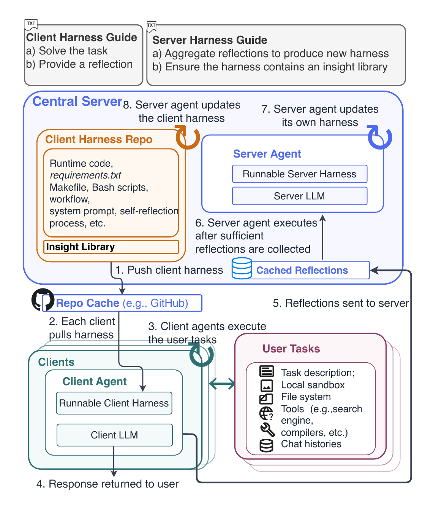

# Federation over Harness (FoH)

FoH evolves the *harness* of a federated multi-agent system from nothing but the agents'
own reflections. Clients solve local tasks with a shared **client harness** (prompts,
tools, workflow, and an insight library) and upload a privacy-safe reflection. A server
agent first evolves its **own harness** for aggregating those reflections, then uses it to
evolve the next client harness. No labels, validation sets, or verifiers are used during
evolution; humans only write two short plaintext guides (`prompt_hub/general.py`) that
bound the search space of each role.

<p align="center"></p>

The task-solving kernel is a pinned release of
[NousResearch/hermes-agent](https://github.com/NousResearch/hermes-agent); the evolvable
parts are the two role overlays `client_agent/` and `server_agent/`.

```
agent_runtime/   protected FoH runtime: Hermes bridge, federation controller, privacy sanitizer,
                 version store, candidate validation, optional git distribution of harnesses
client_agent/    evolvable client overlay (seed) — task solving + reflection
server_agent/    evolvable server overlay (seed) — aggregation + harness revision
prompt_hub/      the two human-written guides (Gs, Gc)
tasks/           benchmark adapters: PinchBench, ClawEval, ScienceAgentBench
client.py        run one task through a chosen client harness
server.py        bootstrap / evolve harnesses from collected reflections
scripts/         one-time bootstrap of the pinned Hermes kernel and PinchBench tools
tests/           unit tests (no model calls: an in-memory responder drives the pipeline)
```

## Setup

Python 3.11–3.13, `git`, and (for real runs) Linux Bubblewrap at `/usr/bin/bwrap`.

```bash
python -m pip install -r requirements.txt
python scripts/bootstrap_hermes.py --python 3.12     # pinned Hermes kernel -> .hermes/ (ignored)
python scripts/bootstrap_pinchbench_tools.py          # Node/gws/gh/fws stack for 4 PinchBench V2 tasks
export OPENROUTER_API_KEY="..."                      # the only credential a run needs
python -m pytest -q                                   # 160 tests, no API calls
```

`config.yaml` selects OpenRouter + `deepseek/deepseek-v4-flash-0731`; `--agent-model` overrides
the model per run and `--judge-model` picks the LLM judge used for grading only.

## Application 1: PinchBench (train) + PinchBench V2 and ClawEval (evaluation)

Train on the 23 PinchBench V1 tasks for 15 iterations. Only their reflections reach the
server; every iteration writes `agent_versions/vNNN/{client_agent,server_agent}` and a
`round_NNN/checkpoint.json`.

```bash
python tasks/task_pinchbench.py --V1-only --suite all --rounds 15 --num-workers 8 \
  --agent-model deepseek/deepseek-v4-flash-0731 --judge-model openai/gpt-5.6-luna-pro \
  --output-dir runs/pinchbench_v1
```

Evaluate a frozen harness version on the 124 held-out V2 tasks and on ClawEval
(the ClawEval runner clones `claw-eval` into `benchmarks/claweval/` on first use):

```bash
V=runs/pinchbench_v1/agent_versions/v015/client_agent
python tasks/task_pinchbench.py --suite all --exclude-V1 --eval-only --agent-version $V \
  --num-workers 8 --judge-model openai/gpt-5.6-luna-pro --output-dir runs/pinchbench_v2_eval_v015
python tasks/task_claweval.py --suite all --eval-only --agent-version $V \
  --num-workers 8 --judge-model openai/gpt-5.6-luna-pro --output-dir runs/claweval_eval_v015
```

Scores: `experiment_summary.json` in each output directory (`final_held_out.held_out_grade`
for evaluation runs; per-round `checkpoint.json` for training). `v000` is the bootstrapped
harness before any reflection; evaluate it the same way for the "no evolution" baseline.

## Application 2: ScienceAgentBench

The runner pins the upstream checkout (`third_party/scienceagentbench.lock.json`) and clones it
into `benchmarks/scienceagentbench/`. Datasets, gold programs, and evaluation scripts are not
redistributable: download `benchmark_verified.zip` from the link in the lock file once.

```bash
python -m pip install -r requirements-scienceagentbench.txt
python tasks/task_scienceagentbench.py --validate-only --benchmark-archive ~/Downloads/benchmark_verified.zip
python tasks/task_scienceagentbench.py --suite 1 --smoke        # grades a gold program; must score 1.0
```

Evolve for 5 iterations on a seeded 50/50 split (51 training / 51 held-out tasks) and
evaluate a frozen version:

```bash
python tasks/task_scienceagentbench.py --suite all --iterations 5 --split 0.5 --seed 42 \
  --num-workers 8 --eval-workers 2 --output-dir runs/scienceagentbench
python tasks/task_scienceagentbench.py --suite all --eval-only \
  --agent-version runs/scienceagentbench/agent_versions/v005/client_agent \
  --output-dir runs/scienceagentbench_eval_v005
```

Grading runs the official verifier in Docker by default; on hosts without a Docker daemon
pass `--container-runtime local` (or `apptainer`). The visual judge defaults to GPT-4o
(`OPENAI_API_KEY`); `--judge-model gemini-2.5-pro` switches it to Gemini. Reported metrics are
the benchmark's `success_rate` (SR) and `valid_program` (VER).

## Running a single task

```bash
python client.py --task "Create answer.txt containing ready." --agent-version runs/pinchbench_v1/agent_versions/v015/client_agent
python server.py --residual-dir residuals --out-dir runs/server_smoke   # one aggregation step
```

## Distributing harnesses through git (optional)

Instead of clients reading the server's filesystem, the server can publish every evolved
harness to a git repository, one branch per iteration. Turn it on in `config.yaml`:

```yaml
harness_git:
  enabled: true
  repo: /shared/foh-harness.git     # bare repo on a shared filesystem, or any git URL (SSH/HTTPS)
  branch_prefix: iteration-
  push: true
```

With this on, the bootstrap pushes `iteration-000` and each round N pushes `iteration-NNN`
containing `client_agent/`, `server_agent/`, `insight_library.json`, and `ITERATION.json`.
Each branch is committed on top of the previous one, so `git diff iteration-004 iteration-005`
is exactly the round-5 harness change. The server records what it pushed in
`<output-dir>/harness_branches.json` and `round_NNN/harness_branch.json`.
A local path that does not exist yet is created as a bare repository automatically.

Clients pull the branch and run it; they never need the server's output directory:

```bash
python -m agent_runtime.harness_git latest --repo /shared/foh-harness.git     # -> iteration-015
python -m agent_runtime.harness_git pull   --repo /shared/foh-harness.git --branch iteration-015 --dest runs/harness
python client.py --task "..." --agent-version runs/harness/client_agent
# or in one step (defaults to the latest iteration branch):
python client.py --task "..." --harness-repo /shared/foh-harness.git --harness-branch iteration-015
python tasks/task_pinchbench.py --eval-only --exclude-V1 --agent-version runs/harness/client_agent ...
```

Only overlay code and the library are committed; credentials, task data, traces, and results
never enter the repository. Distribution settings are not part of the experiment fingerprint,
so enabling them does not change results or block resuming an existing output directory.

## Acknowledgements and licenses

Hermes Agent (MIT) and the PinchBench fixtures (MIT) carry their own licenses under
`third_party/` and `benchmarks/pinchbench/`; ClawEval and ScienceAgentBench are fetched from
their upstream repositories under their respective licenses.
